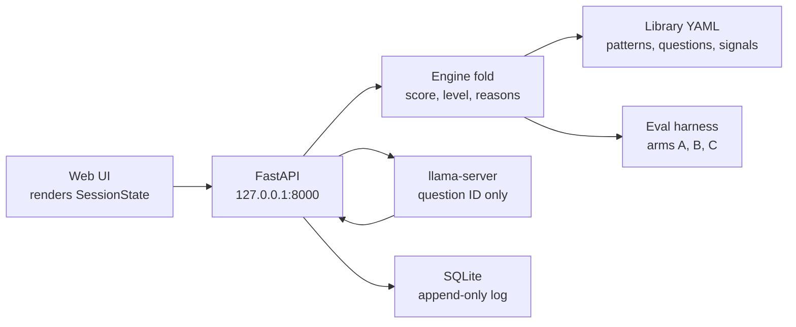

# tellr

tellr is an interview aid for a teller at a fast counter; the teller always decides.

## At a glance

| Topic | In one line |
|---|---|
| What it is | Interview aid; the teller always decides. |
| Demo | 5 scripted synthetic customers, real engine behind it. |
| Real use | Live session, scored by the engine. |
| Model | Llama 3.1 8B picks the next question, benchmarks below. |
| Speed | p50 463.6 ms, p95 482.7 ms, under the 1.5 s budget. |
| Accuracy | 14/15 coached caught, 0/15 false flags on the 30-scenario dev set. |
| Built with | 4 bank themes, Cursor agents, up to 12 in parallel. |
| Entered in | HackPSU Grand Prize, FNB, Nittany AI, MLH SpaceXSI. |

**Jump to:** [How a teller uses it](#how-a-teller-uses-it) · [Demo vs real](#the-demo-and-a-real-visit) · [Llama 8B and benchmarks](#the-llama-8b) · [Specs](#specs-and-tech-stack) · [Safety](#safety-and-bank-concerns) · [Limitations](#limitations--whats-scripted) · [How we built it](#how-we-built-it)

## How a teller uses it

Home is a workstation: the transaction on one side, a copilot card on the other. The card renders one server snapshot. While a save is in flight it keeps that snapshot on screen (`ARCHITECTURE.md`, workstation section).

The copilot shows:

- **Level.** An icon plus a word: Clear, Caution, or High. Colour is not the only cue (`docs/architecture.md` §12; `ARCHITECTURE.md`).
- **Urgency Score.** The server score over the contract maximum, shown as `<score>/<max>`. The score is clamped at +100 (`ARCHITECTURE.md`; `docs/architecture.md` §6.2). Clear is below 25, Caution starts at 25, and High concern starts at 60 (`docs/architecture.md` §6.3).
- **Suggested action.** `talk_track.action` when the server sends one: a short imperative, not a question (`contract/api.md`, CHANGE-007; `ARCHITECTURE.md`).
- **Signals.** Chips the teller can confirm, dismiss, or restore. A teller-sourced chip can read "Teller confirmed." The copilot row hides an "Observed" badge (`docs/handoff/20261025-0828-signal-rows-no-observed.md`).
- **Why this level.** The score explanation: what raised it, what would lower it, a strength word, and collapsed technical details. The panel places server fields. It does not rescore them (`ARCHITECTURE.md`).
- **Timeline.** Step, elapsed time, and speaker. Amounts and phrases such as "on the phone" and "cash" are bold. Speaker is "Customer" (`ARCHITECTURE.md`).
- **Case file.** The control sits with the Transaction heading. The file omits name, age, and gendered pronouns; those stay off the screen and the customer is labeled Customer (`docs/handoff/20261025-0825-home-panel-up-case-file-link.md`; `ARCHITECTURE.md`).

Four outcomes stay available while the visit is open: proceed, slow down, escalate, and report. After the decision, the visit closes and the teller can start a new customer (`docs/architecture.md` §4; `ARCHITECTURE.md`).

Risk, level, reasons, and the next question are computed by the engine. The web UI renders `SessionState`. It does not compute them (`docs/architecture.md` §12; `ARCHITECTURE.md`; `WORKFLOW.md` §9).

## Responsible use

The teller makes the final call. The outcome is a human event, and it requires an actor. No endpoint approves or denies the withdrawal. The copilot suggests a level and a next action. Why this level is the score explanation: what raised it, what would lower it, and a strength word taken from the weights in that response. The panel shows those server fields. It does not compute a new score (`docs/architecture.md` §1, §9; `ARCHITECTURE.md`; `contract/api.md`).

## The demo and a real visit

The demo layout is always on. It is the scripted workstation used for the judging demo: five synthetic customer files play on a timer beside the copilot (`ARCHITECTURE.md`, `web/src/demo/customers.ts`). At 1×, playback targets are routine Friday 20s, car down payment 32s, government impersonation and romance/crypto 45s, and contractor cash 60s. Speed changes wall-clock time only. The on-screen clock is simulated customer time, the sum of each event's `delayMs`. The last two files post no chips (`ARCHITECTURE.md`).

The HackPSU Devpost video is capped at 5 minutes and is meant to cover who, why, how, and future plans (`docs/A_TO_B.md`, M-022). The repo does not include the video file.

**Scripted in that demo**

- The five customer files, their timelines, transaction type, amount, memo, and pacing (`ARCHITECTURE.md`).
- Chips the simulation posts as the file plays, with source `observed`. A manual post uses source `teller` (`ARCHITECTURE.md`).
- Sample data when no API is up. `npm run dev` can fall back to the Vite mock. The mock looks up recorded engine bodies in `web/mock/live_answers.json` and `web/mock/live_levels.json`. It does not score (`ARCHITECTURE.md`).

**Real engine behavior behind it**

- With the API up, `npm run dev:api` scores every answer through the engine. Live session opens send `{ mode: "live", amount_band }` (`ARCHITECTURE.md`).
- The same fold produces the level, the reasons, the pattern, the talk track, and the question. Same events and the same library version produce the same result (`docs/architecture.md` §4).
- The model, when it is on, returns one question ID from a rules-filtered list. Library text is what the teller reads (`docs/architecture.md` §7.4, §8.2).
- The benchmark numbers below are separate runs of that engine, not numbers computed in the browser (`docs/architecture.md` §13; `docs/WRITEUP_NUMBERS.md`).

**A real visit**

A live session cannot load a scenario. The API rejects `scenario_id` when `mode` is `live` (`contract/api.md`; `docs/architecture.md` §14.1). The header pill reads `Simulation: <customer title>` for a synthetic file and `LIVE — no scenario loaded` for a live session with no simulation (`ARCHITECTURE.md`). The teller taps chips and records the outcome. If the model is slower than 1500 ms, or the GPU is down, that turn uses the rule engine, which is a complete product on its own (`docs/architecture.md` §7.3, §14.2). The repo does not describe a feed from a bank's core system.

## How it would actually be used

This is the deployment the spec describes. It is separate from the scripted demo above.

1. The teller opens a **live** session and records an amount band. The API refuses a scenario on that session. A feed that pulls the transaction from a bank's core system is **not built yet** (`contract/api.md`; `docs/architecture.md` §14.1).
2. The teller taps what they see and how the customer answered. Those chips are the inputs (`docs/architecture.md` §4, §5.6–§5.7).
3. The engine folds that log into an urgency score, a level, reasons, and a pattern. The screen displays that result (`docs/architecture.md` §6, §12).
4. The copilot shows the suggested action. When another question is needed, the rules choose it, or the local model returns one allowed question ID (`docs/architecture.md` §7.4; `library/talk_tracks.yaml`).
5. The teller chooses proceed, slow down, escalate, or report. That choice is stored with a human actor, and the visit closes (`docs/architecture.md` §4, §9).

If the model is slower than 1.5 seconds, or the GPU is down, that turn uses the rule engine. The rules-only path was walked end to end (`docs/architecture.md` §14.2; `docs/DECISIONS.md`, Hour 8).

## Limitations / what's scripted

- The judging demo plays five synthetic files on a timer. With no API, the page shows recorded engine answers and does not score them (`ARCHITECTURE.md`).
- A live visit loads no scenario. The teller taps the chips. There is no described connection to a bank's core system (`contract/api.md`; `docs/architecture.md` §14.1).
- On the dev set and the held-out set, the 8B matched the rules on catch and false-flag. The spec says to lead with the adaptive interview in that case, and to report the model as a part that has not yet earned its place (`docs/WRITEUP_NUMBERS.md`; `docs/architecture.md` §19.1).
- The dev miss `scn.coached.bank_perfect_own_account` was left in place. A weight change that caught only that row was tried and not applied. The held-out run, five scenarios per group, missed `scn.coached.ssa_review_rehearsed` on every arm. Those ranges are wide, and the spec says to treat that run as a check, not the headline (`docs/handoff/000-archive.md`, [A-07]; `docs/B_TO_A.md`, B-018; `docs/architecture.md` §13.4).
- A completed compliance or regulatory review is not in the repo. Three patterns are marked `review: compliance` and ship with no signals (`library/patterns.yaml`). External legal claims, including a Senior Safe Act paraphrase, are marked remove (`docs/WRITEUP_NUMBERS.md` §6).
- An in-app editor for scripts, reasons, or themes is not built. There is no settings endpoint (`docs/DECISIONS.md`, Hour 2).
- How to keep the pattern name off a customer's view is still an open choice. The spec lists screen orientation, a privacy filter, or more neutral wording, and it does not record which one was chosen (`docs/architecture.md` §19.4).

## The Llama 8B

The model is **Meta-Llama-3.1-8B-Instruct**, quantized **Q4_K_M**, served locally with `llama-server`. Drivers picked it at hour 6 because a latency bench on an RTX 5070 Laptop put both the 8B and Llama-3.2-3B-Instruct Q4_K_M under the 1.5 s limit and under the ~0.7 s target. The 8B total p95 was 482.7 ms. The 3B is the fallback if VRAM is tight. Quality was not measured in that bench (`docs/DECISIONS.md`, Hour 6; `docs/handoff/000-archive.md`, [A-03]).

Its job is narrow. The opener is fixed, the score and the level are rules, and hypothesis ranking is rules. In strict mode the model only chooses the next question ID among a short candidate list, under a grammar that lists those IDs. It does not write the level, the reasons, or prose (`docs/architecture.md` §7.4, §8.1–§8.2).

The git tag **`weights-frozen`** is `82b788d` (`82b788d1009fe775c3fc5edb20cb5413ee25068e`). It freezes the scoring weights after card A-07. Those weights stayed at the starting table in `library/signals.yaml`. What changed was the static questionnaire's threshold, from 3 to 4, labeled tuned. The tag is not a fine-tune of the Llama file. The repo does not describe training or fine-tuning that model (`docs/handoff/000-archive.md`, [A-07]; `docs/A_TO_B.md`; `docs/A08_HELDOUT_RUN.md`).

### Latency bench (A-03)

RTX 5070 Laptop, 8151 MiB, `llama-server -ngl 99 -c 4096 -np 1`, temperature 0, 3 warm-up runs, then 50 timed. Total is client wall clock. Both models passed L1b (≤1.5 s) and the ~0.7 s target (`docs/handoff/000-archive.md`, [A-03]).

| Model | Total p50 | Total p95 | Prefill p95 | Decode p95 | VRAM |
|---|---:|---:|---:|---:|---:|
| Llama-3.2-3B-Instruct Q4_K_M | 273.2 ms | 296.3 ms | 92.2 ms | 184.0 ms | 4865 MiB |
| Meta-Llama-3.1-8B-Instruct Q4_K_M | 463.6 ms | 482.7 ms | 171.7 ms | 291.9 ms | 7379 MiB |

What those columns measure (`docs/handoff/000-archive.md`, [A-03]; `scripts/bench_llm.py`; `docs/architecture.md` §1, §8.3):

- **Total** is the wait for one reply, timed on the client from send to answer. This is the pause before a question ID comes back.
- **p50** is the 50th percentile of the 50 timed runs, the midpoint of that sample. It is the typical reply in the test.
- **p95** is the 95th percentile, the slow end. The product is built against 1.5 seconds here, because the slow tap is the dead air. The design sketch hoped for about 0.7 seconds. Both models landed under both lines, which is why the bench marked them pass. On a live visit, a model call past 1.5 seconds is handed to the rule engine, so the teller still gets a next question.
- **Prefill** is the server time spent reading the prompt. The design sketch budgets 250 ms at p95. Both rows are under that.
- **Decode** is the server time spent writing the short answer. The sketch budgets 400 ms at p95. Both rows are under that. In this run the writing step was most of the wait.
- **VRAM** is graphics memory in use. The laptop had 8151 MiB. The 8B used 7379 MiB, about 7.4 of 8 GB, which the drivers called tight if anything else needed the GPU. The 3B used less. If the 8B does not fit, the documented fallback is the 3B, or the rules with no model.

A later live-path check on the same laptop, 11 model calls across fixtures T1–T7, warm, fallback 0: 8B p50 663 ms / p95 742 ms / max 765 ms; 3B p50 255 ms / p95 342 ms. Agreement with the rules was 9/11 for both (`docs/handoff/000-archive.md`, [A-05] live p95). Same percentiles as above, on a smaller sample. The max is the slowest of those 11 calls. A fallback is a turn the rules answered because the model missed the 1.5 second cutoff or the server was down. Zero means every one of these calls got a model reply. Agreement is how often that reply was the same question the rules would have picked. The health notes say a rate near 100% means the model is adding wait and nothing else (`docs/architecture.md` §14.2, §16).

### Development set (30 scenarios)

CP3, library 1.2.0, 8B Q4_K_M on the RTX 5070, before the threshold change. Arm A is a fixed questionnaire. Arm B is the product with the rule engine. Arm C is the product with the live 8B. Counts, not percentages. The docs say not to call a difference significant on 15 scenarios per population (`docs/WRITEUP_NUMBERS.md`; `docs/B_TO_A.md`, B-013; `docs/architecture.md` §13.2–§13.3).

| Arm | Catch | False-flag | Mean questions |
|---|---|---|---:|
| A (threshold 3) | 15/15 | 8/15 (95% Wilson 30–75%) | 6.00 |
| B (rules) | 14/15 (95% Wilson 70–99%) | 0/15 (95% Wilson 0–20%) | 3.07 |
| C (live 8B) | 14/15 (95% Wilson 70–99%) | 0/15 (95% Wilson 0–20%) | 3.10 |

What those columns measure (`docs/architecture.md` §13.1–§13.3; `docs/ROSTER.md` §5.2). Each run is 15 coached scenarios and 15 legitimate ones. A coached scenario is a customer who has been walked through a scam story. A legitimate scenario is a genuine reason for the withdrawal, including some with an innocent warning sign.

- **Catch** counts coached scenarios that finish at Caution or High. 15/15 means every coached story was at least Caution. A miss is a coached scenario that finishes Clear. A higher catch means fewer of those Clear finishes. Catch by itself is a weak score: a sheet that marked every customer Caution would catch all 15 and still show no false flags.
- **False-flag** counts legitimate scenarios that finish High. That is a genuine customer marked high concern. The writeup keeps this beside catch so flagging everyone cannot look like a perfect score. On the fixed questionnaire, moving the bar from 3 to 4 took this count from 8/15 to 0/15 and dropped catch with it.
- The **Wilson** range next to a count is a 95% interval. On 15 scenarios it is wide. The spec's own example is that 13/15 still spans roughly 62% to 96%. Read the fraction, and treat a gap between arms as unproven on a sample this small.
- **Mean questions** is the average number of questions before the interview stopped. The spec turns that into time at the window by multiplying by about 13 seconds of human time per question. This run recorded a mean of 40 seconds for the arms that asked about three questions. Arm A asked 6 every time. The low-risk path is meant to finish in under 60 seconds, so this column is the clock. The catch and false-flag columns show what that shorter or longer interview did to coached and legitimate customers.

Arm C on that run: friction 0/15, max 5 questions, scripted time-to-decision mean 40 s, `default_fired` 0/93, validator rejections 0, latency p50 / p95 / max 486 / 576 / 619 ms, no fallbacks. Coached customers finished 1 Clear, 7 Caution, 7 High. All 15 legitimate customers finished Clear. VRAM about 7064/8151 MiB. The shared miss is `scn.coached.bank_perfect_own_account` (`docs/B_TO_A.md`, B-013; `docs/A_TO_B.md`).

The extra figures in that paragraph (`docs/architecture.md` §7.5, §13.1, §13.3–§13.4; `docs/B_TO_A.md`, B-013):

- **Friction** counts legitimate scenarios that finish Caution or High, not High alone. It is the genuine customers who still leave under some concern. False-flag hides them when they are only Caution. Here friction is 0/15, matching a sheet of all Clear.
- **default_fired** counts questions the scenario had no scripted answer for, so a generic answer was used. 0/93 means every question was one the scenario knew how to answer. A high rate means the test is weaker than it looks.
- **Validator rejections** count model replies that named a question outside the allowed list. Those are dropped and the rules' question is used. Zero means that did not happen on this run.
- **Latency** here is model time with the eval timeout turned off, so it is not the live 1.5 second test. p50, p95, and max are the midpoint, the slow end, and the slowest call. The live check is the bench above.
- **Fallback** on the live path is a turn the rules answered because the model missed the time cutoff, or the GPU was unavailable. When that happens, the rules supply the question for that turn. This eval reported none.

A-07 then moved only arm A's threshold from 3 to 4. Scoring weights were not changed (`docs/WRITEUP_NUMBERS.md`; `docs/handoff/000-archive.md`, [A-07]).

| Arm A | Catch | False-flag | Friction | Mean questions |
|---|---|---|---|---:|
| Before (threshold 3) | 15/15 | 8/15 | 8/15 | 6.00 |
| After (threshold 4) | 13/15 | 0/15 | 0/15 | 6.00 |

Catch, false-flag, and mean questions are the same measures as the table above. Friction is defined in that note. The threshold is how many "concerning" answers the fixed questionnaire needs before it flags someone. It moved from 3 to 4. All eight false flags had a count of 3, so 4 clears them, and friction falls in step because those eight were High. Two coached scenarios sat on that same count and become misses. The questionnaire is no shorter: it still asks 6 questions. For a teller using that fixed sheet, fewer genuine customers are marked High, and two scam stories that used to be caught now finish Clear (`docs/handoff/000-archive.md`, [A-07]; `docs/architecture.md` §13.3–§13.4).

New arm A misses after the change: `scn.coached.gov_perfect_fine` and `scn.coached.tech_refund_perfect`. Arm B stayed 14/15 catch, 0/15 false-flag, mean 3.07 questions (`docs/handoff/000-archive.md`, [A-07]).

### Held-out (10 scenarios, run once)

Five coached and five legitimate, written in a worktree that could not see the dev scenarios or the weights, then run once on Driver B's GPU laptop. No rerun. Arm C matched arm B on catch rate and false-flag rate on this set and on the dev set (`docs/WRITEUP_NUMBERS.md`; `docs/B_TO_A.md`, B-018; `WORKFLOW.md` §10).

| Arm | Catch | False-flag | Friction | Mean questions | Coached Clear / Caution / High | Legitimate Clear / Caution / High |
|---|---|---|---|---:|---|---|
| A | 4/5 (Wilson 38–96%) | 1/5 (Wilson 4–62%) | 1/5 | 6.00 | 1 / 0 / 4 | 4 / 0 / 1 |
| B | 4/5 (Wilson 38–96%) | 0/5 (Wilson 0–43%) | 0/5 | 2.30 | 1 / 0 / 4 | 5 / 0 / 0 |
| C | 4/5 (Wilson 38–96%) | 0/5 (Wilson 0–43%) | 0/5 | 2.30 | 1 / 0 / 4 | 5 / 0 / 0 |

Same measures as above, on 5 coached and 5 legitimate scenarios. One scenario moves a rate by 1/5, so the Wilson ranges are very wide. The spec says to read this run as a check that the 30-scenario result was not a one-time fit, not as the headline rate. A catch of 4/5 with a range of 38–96% is consistent with anything from a bit over a third to nearly all. The level columns are the raw counts behind those rates: a coached Clear is a miss, a legitimate High is a false flag, and a legitimate Caution or High is friction (`docs/architecture.md` §13.3–§13.4; `docs/B_TO_A.md`, B-018).

On time at the window, this run already multiplied questions by 13 seconds. Arm A's mean of 6.00 questions is 78 seconds. Arms B and C, mean 2.30 questions, are 30 seconds mean and 39 seconds max. On this one run, B and C match A's 4/5 catch, and their false-flag count is 0/5 where A's is 1/5. The ranges overlap by a lot, so that is the count for these 10 scenarios, not a settled gap (`docs/B_TO_A.md`, B-018; `docs/architecture.md` §13.4).

Arm C latency p50 / p95 / max was 354 / 405 / 410 ms, fallback 0/13, validator rejections 0, VRAM peak 7114/8151 MiB. Every arm missed `scn.coached.ssa_review_rehearsed`. Arm A's false flag was `scn.legitimate.shelter_adoption_fuzzy` (`docs/B_TO_A.md`, B-018; `docs/WRITEUP_NUMBERS.md`). Those latency figures are again model time with the eval timeout off. Fallback 0/13 means all 13 model calls were answered by the model. The server stayed up. Validator rejections and VRAM mean the same thing as in the development run.

## Reproduce our numbers

Gates, from the repo root. `a` is the Python suite, `b` is the web suite, and `contract` checks the fixtures against `reference_impl.py` (`ARCHITECTURE.md`).

```bash
scripts/gate.sh a
scripts/gate.sh b
scripts/gate.sh contract
```

The benchmarks need a local `llama-server` with the 8B Q4_K_M: `-ngl 99 -c 4096 -np 1`, listening on `127.0.0.1:8080`. One GPU job at a time. On Git Bash or WSL, prefix model jobs with `scripts/with-gpu`. On native Windows, skip that wrapper (`docs/CP3_GPU_RUN.md`; `docs/ROSTER.md` §5.3).

Latency bench, from the script header. Defaults are 50 runs and 3 warm-ups (`scripts/bench_llm.py`):

```bash
python scripts/bench_llm.py --server http://127.0.0.1:8080 --runs 50 --label 8B
```

Development eval (`docs/CP3_GPU_RUN.md`):

```bash
scripts/with-gpu env LLAMA_SERVER=http://127.0.0.1:8080 \
  MODEL_ID=Meta-Llama-3.1-8B-Instruct-Q4_K_M \
  python -m eval.run --scenarios eval/scenarios/dev \
  --out eval/results/$(git rev-parse HEAD) \
  --arms A,B,C --model local
```

Held-out eval, once (`docs/A08_HELDOUT_RUN.md`). Confirm `git rev-parse weights-frozen` is `82b788d` first.

```bash
scripts/with-gpu env LLAMA_SERVER=http://127.0.0.1:8080 \
  MODEL_ID=Meta-Llama-3.1-8B-Instruct-Q4_K_M \
  python -m eval.run --scenarios eval/scenarios/heldout \
  --out eval/results/heldout \
  --arms A,B,C --model local
```

## How it's built

The browser draws state. The API appends facts, folds them, and sometimes asks the model for one ID. The eval harness imports the same engine and does not go through HTTP (`docs/architecture.md` §3, §13).



Four bank themes share one layout. `?theme=` or the `T` key cycles `tellr` → `pnc` → `mtb` → `fnb`. Color, font family, and the brand mark are what change. Screens read colour tokens. The bank id does not change the layout, the copy, or the score. Each theme has a light palette and a dark palette, plus Light / Dark / System. F.N.B. is the `fnb` theme, one of the four examples on that shared UI, and the team is opting into the FNB Challenge (`ARCHITECTURE.md`, themes section; `docs/B_TO_A.md`; `docs/A_TO_B.md`, M-022).

| Id | Theme |
|---|---|
| `tellr` | Default. Poppins, navy-to-indigo |
| `pnc` | PNC. Arial, orange on slate |
| `mtb` | M&T. Segoe UI, green |
| `fnb` | F.N.B. Gold wordmark on the dark field |

The contract in `contract/` is the frozen interface. `CONTRACT_VERSION` is 2.0.0. Every session response is a full `SessionState`. Fixtures T1–T7 are generated from `reference_impl.py`, and both sides test against them. A change is a written `CHANGE-nnn`, approval from both drivers, then an apply on `main` (`contract/api.md`; `WORKFLOW.md` §5).

## Specs and tech stack

| Piece | What the repo records | What it does |
|---|---|---|
| Training hardware | Sebastian states an RTX 5070 was used to train the Llama 8B. That training run is not written down in the repo. | The graphics card named for training the question-picking model. |
| Inference hardware | NVIDIA GeForce RTX 5070 Laptop, 8151 MiB VRAM, driver 592.01, Windows. llama.cpp b11865, CUDA 13.4. `llama-server -ngl 99 -c 4096 -np 1`. The 8B used 7379 MiB in the latency bench (`docs/handoff/000-archive.md`, [A-03]; `docs/DECISIONS.md`). | The laptop that ran the measured question-picking calls and the eval. |
| Base model | Meta-Llama-3.1-8B-Instruct, Q4_K_M, bartowski GGUF. Llama-3.2-3B-Instruct Q4_K_M is the fallback (`docs/DECISIONS.md`; `docs/handoff/000-archive.md`, [A-03]). | Picks one allowed question ID. It does not write the score or the words the teller reads. |
| Fine-tune | Not described. No LoRA, QLoRA, epoch count, dataset size, or training time is in the repo. Tag `weights-frozen` (`82b788d`) freezes the scoring weights, not a Llama training checkpoint (`docs/handoff/000-archive.md`, [A-07]; `docs/A08_HELDOUT_RUN.md`). | The score table is frozen. How the 8B weights were trained is not in these files. |
| Engine | Python >= 3.12. FastAPI, uvicorn, and Pydantic >= 2 are declared with no FastAPI version pin. Pytest and Ruff are the test and lint tools (`pyproject.toml`). `reference_impl.py` is the scoring oracle. Golden tests load `tests/golden/reference_weights.yaml` (`WORKFLOW.md` §4). | Folds the teller's taps into a score, a level, and reasons. The golden tests check that fold against the reference. |
| Store | SQLite. Events reject updates (`store/sqlite.py`). | Keeps the visit log. |
| Frontend | React 19.3.1, Vite 8.3.5, TypeScript 6.0.3 with `strict: true`, Tailwind CSS 4.3.3. Tests run on Vitest 5.0.5. The gate script asks for Node 20+ (`web/package.json`; `web/package-lock.json`; `web/tsconfig.json`; `scripts/gate.sh`). | Draws the workstation. It does not compute the score. |
| API contract | `CONTRACT_VERSION` 2.0.0. Every session response is a `SessionState`. Fixtures T1–T7 come from `reference_impl.py` (`contract/api.md`). | The frozen shape both the engine and the screen share. |
| Themes | `tellr`, `pnc`, `mtb`, `fnb`. Color, font, and brand mark (`ARCHITECTURE.md`). | Same screens, four bank looks. |
| Gate | `scripts/gate.sh a` runs Ruff, pytest, import-linter, and the contract check. `scripts/gate.sh b` runs the TypeScript check, ESLint, Vitest, and the contract check (`scripts/gate.sh`). | The automated check a change has to pass. |
| Development | Cursor agents, including cloud agents. One fresh agent per task, on its own branch. Two drivers steer (`docs/handoff/20261025-0828-signal-rows-no-observed.md`). | How the code was written. |

The engine does the thinking that can be checked. The screen shows it. The 8B only chooses the next question. Sebastian states that model was trained on an RTX 5070. The notes in this repo describe the published Instruct model, quantized Q4_K_M, running on an RTX 5070 Laptop for inference. They do not record a training recipe.

## Templates

The words on screen, and the bank chrome, are files. The model does not write them. There is no settings screen for editing them. A settings endpoint was rejected (`docs/DECISIONS.md`, Hour 2; `contract/api.md`).

- **Suggested action.** `library/talk_tracks.yaml` holds the short action the copilot shows, and an avoid list of phrases not to use. The engine uses the track for the suggested outcome (`engine/rules.py`; `docs/architecture.md` §7).
- **Factor reasons.** Every signal in `library/signals.yaml` has a rationale. The library refuses to boot if that text is blank. The rationale is the only explanation text the product shows (`engine/library.py`; `docs/architecture.md` §5.5).
- **Questions.** The question text and its one-line why live in the library. The model returns an ID. The screen looks the words up (`docs/architecture.md` §7.4).
- **Bank themes.** Each bank is one file in `web/src/theme/themes/`. It sets color, font, and the brand mark. Layout and scoring stay the same (`ARCHITECTURE.md`).

Customizing this repo means editing those files. A new theme is a new file. A new reason is a rationale. Score weights are a different matter: they are frozen at `weights-frozen`, and the golden tests keep using `tests/golden/reference_weights.yaml` (`docs/handoff/000-archive.md`, [A-07]; `WORKFLOW.md` §4). An editor inside the app is **not built yet**.

## Safety and bank concerns

- **A person decides.** The outcome requires a human actor. All four choices stay available while the visit is open. The copilot suggests. It does not approve or deny the withdrawal (`docs/architecture.md` §1, §9).
- **The level is explainable.** Each flag carries a library rationale. Why this level shows what raised the score and what would lower it. The model cannot write that text (`docs/architecture.md` §5.5, §9; `ARCHITECTURE.md`).
- **What the score is allowed to use.** The engine's library models have no age, appearance, or customer-name field. Stated purpose routes questions and does not enter the score. A prompt test rejects age, appearance, a teller note, the amount band, and an account reference (`engine/library.py`; `tests/recommenders/test_prompt.py`; `docs/architecture.md` §9, §10.2). One chip is about the person, "unusual for this customer," at weight 8, with no probe and no pattern. Context alone cannot reach High (`library/signals.yaml`; `docs/architecture.md` §6.2, §18.9).
- **What the demo stores and shows.** The five customer files are synthetic. Name and age band may sit in the payload and are not rendered. The screen says Customer (`ARCHITECTURE.md`). A session stores chips, a purpose category, and answers. It does not store a recording of what the customer said. There is no audio. The default model runs on localhost (`docs/architecture.md` §10.1, §10.3, §15).
- **The log.** Events sit in SQLite. The database rejects an update to an event, and it rejects deleting events while the session is open. Undo adds a marker. The session row pins the library version the fold used (`store/sqlite.py`; `docs/architecture.md` §4, §10.1). A function can delete closed sessions past a retention window, events first. The API does not call it, so a running purge is **not built yet** (`store/sqlite.py`).
- **Frozen weights, contract, and goldens.** Tag `weights-frozen` freezes the scoring weights. It is not a freeze of a trained Llama file. This repo uses the published Instruct model. Golden tests compare the engine with `reference_impl.py` and a separate reference weight file, and those expected results are not edited to force a pass. The API contract changes only when both drivers approve a written CHANGE (`WORKFLOW.md` §4–§5; `docs/A08_HELDOUT_RUN.md`).
- **If the model or the engine is unavailable.** A model call past 1.5 seconds uses the rules for that turn. The server can boot with `RECOMMENDER=rules`, and that path was checked end to end (`docs/architecture.md` §14.2; `docs/DECISIONS.md`, Hour 8). If the API is down, the demo page shows recorded sample data and does not score (`ARCHITECTURE.md`). A recorded log can be replayed (`docs/architecture.md` §14.2).
- **Compliance review a bank would still do.** Government impersonation, family emergency, and tech support are marked `review: compliance` and include no signals, because the spec named them and did not define them (`library/patterns.yaml`). No legal sign-off is in the repo. That review is **not built yet**.

## How we built it

Two people steered. The agents wrote the code. Driver A, Sebastian, watched the engine and the evaluation. Driver B, Jonathan, watched the screen, the API, and the GPU laptop. They kept two running notes, `docs/A_TO_B.md` and `docs/B_TO_A.md`. When one side found a problem in the other's work, they logged it in `docs/CROSS_LANE.md` and left the fix to the owner (`docs/ROSTER.md` §2; `WORKFLOW.md` §7).

Each task or fix got a fresh AI agent and its own branch. Agents worked side by side. They told each other which files they owned, using a one-page map (`ARCHITECTURE.md`) and a short handoff note, so two agents were not editing the same place. A shared file has one owner. The agreement between the engine and the screen stays frozen unless both drivers approve a written change (`docs/ROSTER.md` §3; `WORKFLOW.md` §5; `docs/HANDOFF.md`).

We ran up to 12 agents in parallel.

The life of a change:

1. **Idea.** A driver names the task.
2. **Agent.** A new agent takes that task.
3. **Branch.** The work sits on its own branch, with a note for the next agent.
4. **Gate.** An automated check has to pass before the change can land. `scripts/gate.sh` runs the Python checks, the web checks, or the contract check (`ARCHITECTURE.md`).
5. **Merge.** A driver merges one branch at a time, after the gate (`WORKFLOW.md` §7).

## Entered in

From the HackPSU Fall 2026 Devpost page, as recorded by the drivers: the Grand Prize is $3,500 (1st $2,000, 2nd $1,000, 3rd $500) and is the default entry for non-case submissions. The team is also opting into the FNB Challenge, the Nittany AI Challenge, and MLH SpaceXSI. The submission had to be created by midnight, with a hard deadline of noon Sunday (`docs/A_TO_B.md`, M-022; `docs/B_TO_A.md`, B-030).

**Best use of Cursor.** The build itself is the Cursor entry. Two people kept a frozen contract and a one-page map, and agents took cards on separate branches. Section "How we built it" is that workflow: gates on every PR, a change protocol, and a straight line of merged pull requests.

## What's next

These are open in the spec. They are not in this build.

- Spanish wording is a stretch goal. It would be more columns in the library, because the model writes no sentences (`docs/architecture.md` §12).
- Whether the customer's own words should reach the model is undecided. That field is the only route to one signal, and strict mode keeps free text out (`docs/architecture.md` §19.2, §10.2).
- The pattern name is for the teller. The spec says it is the wrong text for the customer to read, and that the demo should show how the screen handles that (`docs/architecture.md` §19.4).
- Several tellers at once are out of scope for the 24-hour build. The event log could be routed later. One shared model server would be the bottleneck (`docs/architecture.md` §19.5).

## Quick start

Python 3.12. Dependencies are listed in `pyproject.toml`. The Makefile starts the API and the web app in tmux (`Makefile`; `pyproject.toml`).

```bash
make dev-api    # uvicorn on 127.0.0.1:8000
make dev-web    # Vite on 127.0.0.1:5173, mock installed
```

The same processes without Make (`ARCHITECTURE.md`):

```bash
python -m uvicorn api.main:app --port 8000
```

```bash
cd web
npm run dev       # sample data if the API is down
npm run dev:api   # pins VITE_API_URL to http://127.0.0.1:8000
```

Gate and benchmark commands are in [Reproduce our numbers](#reproduce-our-numbers).

## Repo layout

| Path | What it is |
|---|---|
| `engine/`, `library/` | Score, questions, signals |
| `api/`, `store/`, `recommenders/` | HTTP, SQLite, model client |
| `eval/` | Scenarios and the three arms |
| `web/` | React workstation and the four themes |
| `contract/` | Frozen schemas and T1–T7 fixtures |
| `docs/architecture.md` | Spec v1.2 |
| `ARCHITECTURE.md` | Map of the repo |
| `reference_impl.py` | Executable spec of the scoring rules |
| `scripts/gate.sh` | The PR gate |

## Team

Driver A, Sebastian. Driver B, Jonathan. The roster pairs Sebastian with the engine and the evaluation, and Jonathan with the frontend, the API, and the held-out set (`docs/ROSTER.md` §2; `docs/DECISIONS.md`).
