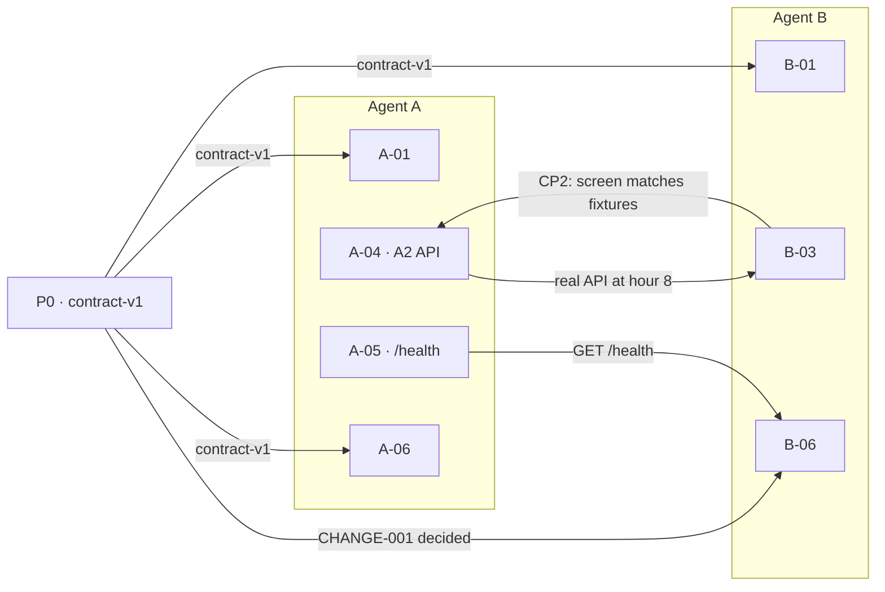

# Cross-lane step map

Either lane can pick up the other's card in a special case. This file is the map: owner, hour, dependencies, the card's own paths, the outputs, and which cards on the other side use that output. Sources: `WORKFLOW.md` §6–§7, `docs/ROSTER.md`, and the task cards (`prompts/P0-contract.md`, `prompts/A-01.md`–`A-08.md`, `prompts/B-01.md`–`B-06.md`). Same-lane order is the Depends column. §2 draws only the edges that cross lanes.

A-01 and A-04 are one card each, split between A1 and A2 (roster §4). Paths are that card's "You may create or edit" list.

B-07 and J-01 belong to the held-out writer.

## 1. Cards

| Card | Owner | Hour / checkpoint | Depends on | Owned paths | Outputs / tags | Other-lane consumers |
|---|---|---|---|---|---|---|
| P0 | R drives; A1, A2, A3, and B1 review | 0–2 · stop for the hour-2 contract decision | Kit as shipped | `contract/**`, `docs/QUESTIONS.md`, `docs/DECISIONS.md` | `scripts/gate.sh contract`; tag `contract-v1`; both drivers ticked in `contract/CHANGES.md`; every question answered or deferred | A-01, A-06, B-01 (`contract-v1`); B-06 (CHANGE-001 decided) |
| A-01 | A1 library and engine interface (hours 2–3); A2 skeleton, store, GPU lock (hours 2–4) | 2–4 · tag `engine-api-v1` at hour 3 | `contract-v1` | A1: `engine/__init__.py`, `engine/library.py`, `engine/testing.py`, `library/*.yaml`, `tests/library/**`. A2: `pyproject.toml`, `Makefile`, `.importlinter`, `tests/conftest.py`, `store/sqlite.py`, `tests/store/**`, `scripts/with-gpu` | A1: tag `engine-api-v1`, `FakeEngine`. A2: `scripts/gate.sh a`, store tests, `make dev-api`, `scripts/with-gpu` | None. B stays on the fixtures until B-03 |
| A-02 | A1 (card header: Agent A) | 4–6 | A-01 merged | `engine/events.py`, `engine/reduce.py`, `engine/score.py`, `engine/hypotheses.py`, `tests/engine/**`, `tests/golden/test_scores.py` | `scripts/gate.sh a`; property test under 60 seconds | None |
| A-03 | A2 (card header: Agent A; A2 holds the GPU lock) | Hour 6, at most 30 minutes · **CP1** | A-02 merged | `scripts/bench_llm.py` | p50/p95 per model in `docs/HANDOFF.md`, via `scripts/with-gpu`; drivers write the model choice in `docs/DECISIONS.md`. Stop. A-05 waits for that choice | None. B-02 polish continues in parallel on the fixtures |
| A-04 | A1 engine half; A2 API half | 6–8 · **CP2** on the A2 half | A1: A-02 merged and the CP1 model decision. A2: those, plus `engine-api-v1` (the swap-in also needs A1's real engine) | A1: `engine/eligibility.py`, `engine/stop.py`, `engine/rules.py`, `tests/golden/test_traces.py`. A2: `api/**`, `tests/api/**`, `Makefile` | A1: T1–T7 match `reference_impl.py`. A2: `scripts/gate.sh a`, contract conformance green, a `curl` walkthrough of T2 in HANDOFF | B-03 (hour-8 switch to the real API; joint CP2) |
| A-05 | A2 (card: Agent A, or A2) | 8–12 | CP2 passed | `recommenders/**`, `engine/prompt.py`, `api/**` (only `/health` and recommender wiring), `tests/recommenders/**` | `scripts/gate.sh a`; golden tests still pass with `RECOMMENDER=rules`; live-path p95 in HANDOFF | B-06 (`GET /health`). CHANGE-001 is rejected, so Settings stays read-only |
| A-06 | A3 | 2–15 · **CP3** at hour 15 | `contract-v1` | `eval/**`. Roster keeps `eval/scenarios/heldout/` with the held-out writer | `scripts/gate.sh a`; `eval/PREREGISTRATION.md` committed before any results; `report.md`; stop for the drivers | None of B-01–B-06. CP3 is the drivers reading the report |
| A-07 | A1 | 18–20 | CP3 decision recorded | `library/signals.yaml`; append a Tuning section to `eval/PREREGISTRATION.md`; live-weights parametrization in `tests/engine/test_properties.py` | `scripts/gate.sh a`; tag `weights-frozen`; tuned development report labelled "tuned" | None of B-01–B-06 |
| A-08 | A3 | 20–21 | B-07 merged | `eval/results/**`; `eval/report additions` | Results committed; the exact commit SHA in HANDOFF | None of B-01–B-06 |
| B-01 | B1 (card: Agent B) | 2–4 | `contract-v1` | `web/**` | `scripts/gate.sh b`; Interview-shell screenshot (T2, second answer) in HANDOFF | None |
| B-02 | B1 | 4–6 | B-01 merged | `web/**` | `scripts/gate.sh b`; three spot-check screenshots in HANDOFF | None |
| B-03 | B1 | 6–8 · **CP2** | B-02 merged. The hour-8 step uses A-04's API | `web/**` | `scripts/gate.sh b`; integration notes in HANDOFF; CP2 confirmed with A | A-04's CP2 exit (B's screen matches the fixtures through the real API) |
| B-04 | B1 | 8–12 | CP2 passed | `web/**` | `scripts/gate.sh b` | None |
| B-05 | B1. Optional Playwright and the accessibility audit can sit with B2 | 12–15 | B-04 merged | `web/**` | `scripts/gate.sh b` | None |
| B-06 | B1, or B2 if added at hour 8 (then hours 8–12) | 18–20 | CHANGE-001 decided in P0 | `web/**` | `scripts/gate.sh b`. CHANGE-001 is rejected: show `/health` read-only and note that the fallback switch is config-only | None |

`WORKFLOW.md` §6 is the one-agent grid and places A-06 in hours 12–15. The A-06 card and roster §4 start A3 at hour 2 and keep CP3 at hour 15.

## 2. Dependency map

Cross-lane edges only.

A-02, A-03, A-07, A-08, B-02, B-04, and B-05 have no consumer on the other lane. A-03's model choice is the CP1 driver decision that A-04 (same lane) requires.

## 3. Doing the other lane's part

### When it is allowed

Only after both drivers say yes. The usual reasons are a hardware need (A-03 on Driver B's GPU, because A has no GPU) or an owner who is blocked. Ownership stays with the card owner. Architecture §9 still applies.

### Protocol

1. Both drivers approve the pickup before any edit.
2. Use a branch named after the card.
3. Edit only the paths on that card's "You may create or edit" list.
4. Run that card's own gate: `scripts/gate.sh a`, `scripts/gate.sh b`, or `scripts/gate.sh contract` when the card names one. When Done when lists no gate script, meet that Done when and stop.
5. Append `docs/HANDOFF.md` with the card's template and name who ran it.
6. The owner reviews the diff.
7. Nothing is merged unless the drivers merge it.

### How this relates to the other logs

This file is the step map, the pickup protocol, and the swap log. `docs/CROSS_LANE.md` is the issue log for cross-lane blockers, mismatches, and requests. `docs/QUESTIONS.md` is the spec log: agents append, drivers answer, and an open question blocks only the work that depends on it. Contract changes follow `WORKFLOW.md` §5 and start in `docs/QUESTIONS.md`.

File the problem in `docs/CROSS_LANE.md` or `docs/QUESTIONS.md`. After both drivers approve a pickup, add a row in §4 and the HANDOFF entry. Spec questions stay open until a driver answers them. Weights, golden expectations, and `contract/` change only through their own processes.

## 4. Special-case swaps

| Card | Run by | Why | Approved | Status |
|---|---|---|---|---|
| A-03 · latency benchmark | Driver B (Jonathan), on his RTX 5070 laptop GPU | A has no GPU | Driver B (Jonathan) authorized the laptop run, 2026-10-24 15:55. Driver A (Sebastian) accepted it by merging PR #16, 2026-10-24T19:56:31Z | done (PR #16 merged) |

A-03 sources for that row:

- Driver B (Jonathan) authorized running it on his laptop. `docs/HANDOFF.md` records `[A-03] Latency benchmark — Agent A (run on Jonathan's laptop) — 2026-10-24 15:55`, status done, on an RTX 5070 Laptop GPU. PR #16, opened by jonathanzheng2020-eng, says it was run by Driver B on Jonathan's GPU because A has no GPU. `docs/A_TO_B.md` names Driver B as Jonathan.
- Driver A (Sebastian) accepted that run by merging PR #16 at 2026-10-24T19:56:31Z (`mergedBy` SirBastion2). On the PR branch, `497324647e425ee9b56202a08046abb82b1d8bbd` (2026-10-24T19:55:38Z), co-authored by Sebastian, keeps the A-03 entry in `docs/HANDOFF.md`. `docs/DECISIONS.md` and `docs/A_TO_B.md` name Driver A as Sebastian.
- `docs/B_TO_A.md` has no entry for this run. No earlier Driver A approval of the pickup is written in `docs/DECISIONS.md`, `docs/HANDOFF.md`, `docs/A_TO_B.md`, or `docs/B_TO_A.md`. The merge of PR #16 is the acceptance on record. This row is the cross-lane run, not the Hour 6 model choice: `docs/DECISIONS.md` records that choice by Driver A (Sebastian) on 2026-10-24, and Driver B has not co-signed it.
